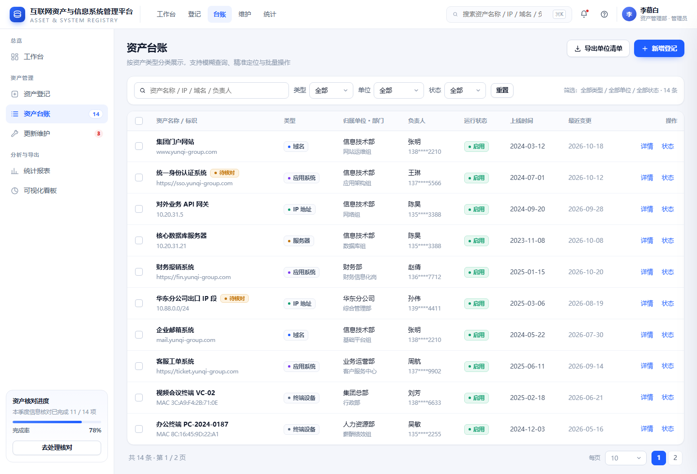
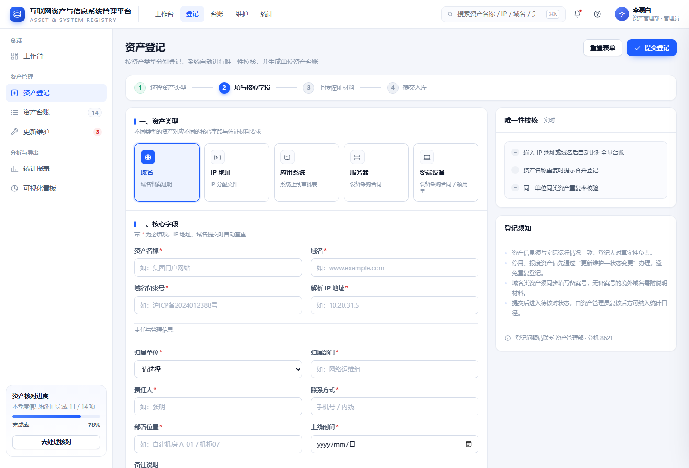
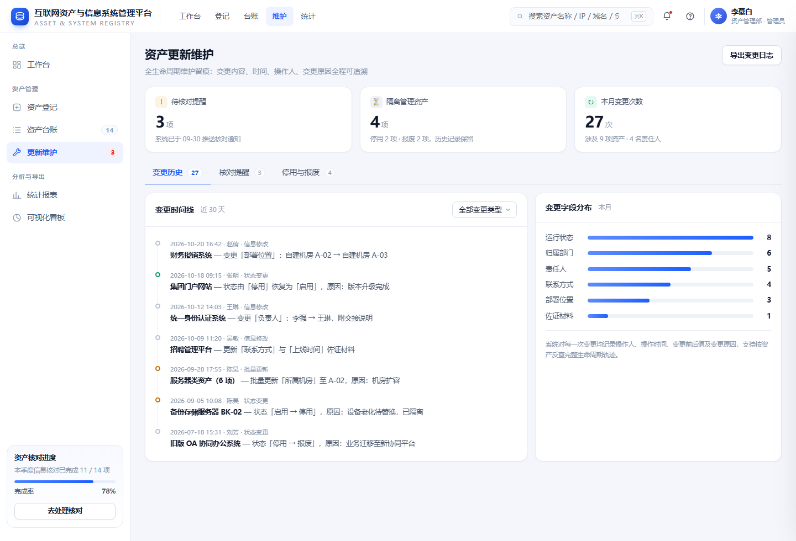
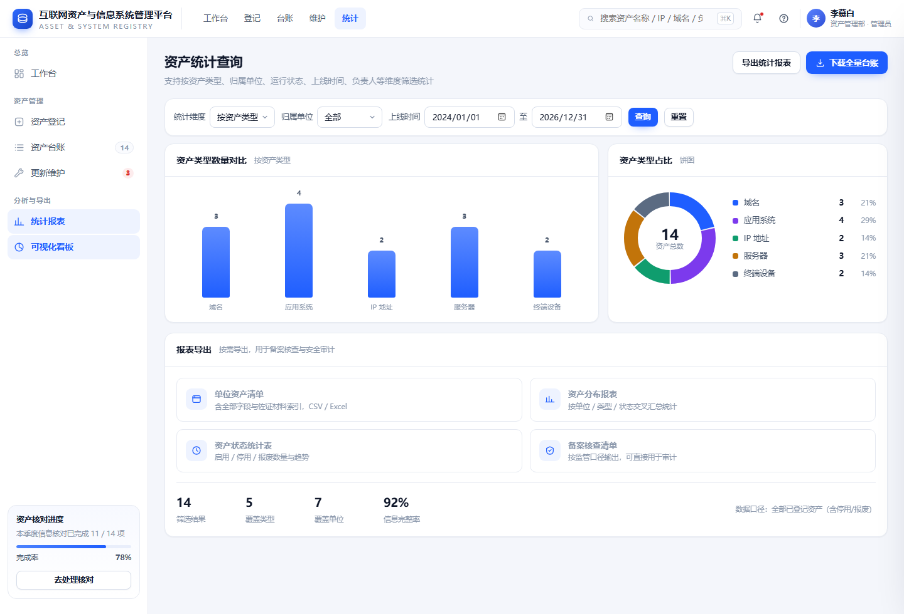
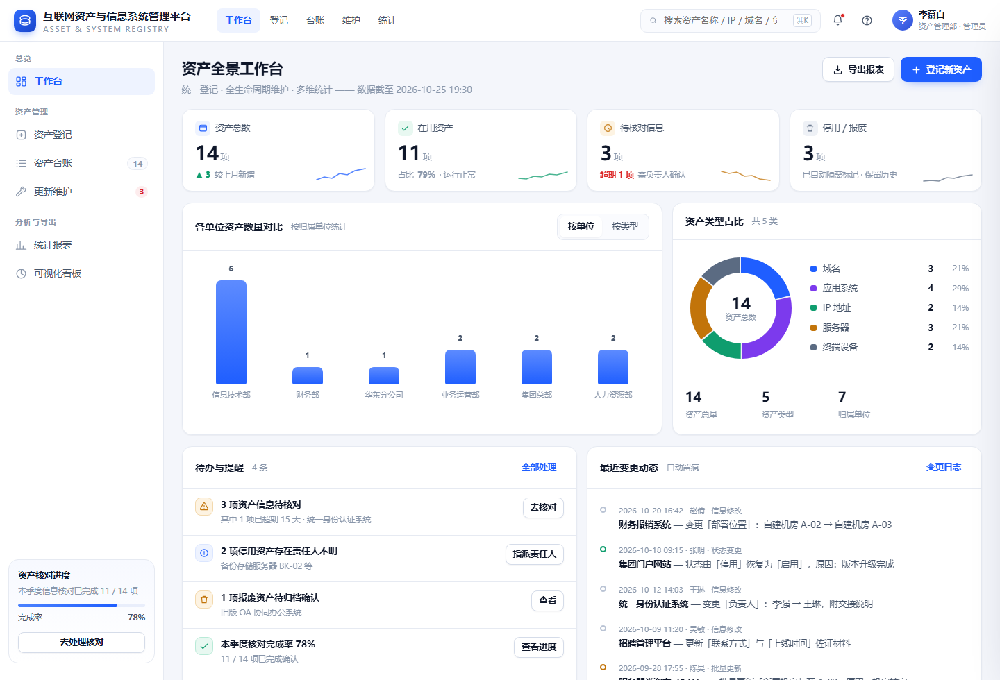

# 互联网资产与信息系统管理平台

> Internet Asset & Information System Registry — 需求规格说明书（SRS）+ 可交互 UI 原型

一套面向单位内部互联网资产治理的「登记 → 维护 → 统计」闭环方案。本仓库同时包含**需求规格说明书**（A4 排版，PDF + 可编辑 HTML）与**零依赖可交互原型**（单文件 HTML，双击即可运行），用于需求评审、设计走查与开发对齐。



---

## 目录

- [项目简介](#项目简介)
- [在线预览](#在线预览)
- [目录结构](#目录结构)
- [快速开始](#快速开始)
- [功能覆盖](#功能覆盖)
- [设计系统](#设计系统)
- [需求规格说明书](#需求规格说明书)
- [技术实现](#技术实现)
- [待确认事项](#待确认事项)

---

## 项目简介

单位内的互联网资产（域名、IP、应用系统、服务器、终端设备）多分散在各单位、以 Excel 台账人工维护，普遍存在**登记口径不一、重复登记、责任人不明、状态更新滞后、停用报废资产长期"挂在账上"、统计口径无法支撑核查与审计**等问题。

本项目把原始业务需求翻译为一套可落地的产品方案，分三层闭环：

| 层次 | 目标 | 关键机制 |
| --- | --- | --- |
| 登记标准化 | 源头保证数据真实、合规、不冗余 | 五类资产独立字段模板 + 佐证材料上传 + IP/域名实时查重拦截 |
| 维护全周期 | 责任可追溯，杜绝"僵尸资产" | 启用/停用/报废状态流转、变更四要素留痕、批量操作、隔离管理、季度核对 |
| 查询多维化 | 支撑决策与外部核查 | 五维度组合筛选、模糊 + 精准检索、可视化图表、标准报表导出 |

## 在线预览

- **UI 原型（交互演示）**：https://aimiliya825.github.io/internet-asset-registry/
- **需求规格说明书（HTML 版）**：[在线查看](https://aimiliya825.github.io/internet-asset-registry/%E9%9C%80%E6%B1%82%E8%A7%84%E6%A0%BC%E8%AF%B4%E6%98%8E%E4%B9%A6.html)

也可用 URL hash 直达原型指定页面：

```
#dashboard   资产全景工作台
#register    资产登记
#ledger      资产台账
#maintain    更新维护
#stats       统计报表
```

例如：https://aimiliya825.github.io/internet-asset-registry/#register

## 目录结构

```
.
├─ index.html                     # 可交互 UI 原型（单文件，零外部依赖）
├─ 需求规格说明书.html             # 需求规格说明书（A4 屏显版，可直接编辑）
├─ 需求规格说明书.pdf              # 需求规格说明书（定稿 PDF）
└─ docs/
   └─ screenshots/                # 五个页面的界面截图
```

## 快速开始

```bash
git clone https://github.com/aimiliya825/internet-asset-registry.git
cd internet-asset-registry
# 直接双击 index.html，或用任意静态服务器
python -m http.server 8080
```

原型不依赖任何 CDN、图标库或构建工具，离线打开即可完整交互（图标为内联 SVG，图表为 SVG + CSS 绘制）。

## 功能覆盖

### 资产登记上传

- 五类资产（域名 / IP 地址 / 应用系统 / 服务器 / 终端设备）类型卡片切换，**表单字段、必填规则、材料要求同步变更**；
- 核心字段分组呈现：登记信息 / 责任与管理 / 时间与位置；
- **实时唯一性校验**：输入 IP、域名、MAC 即比对全量台账，命中重复时红色提示「重复对象 + 归属单位 + 当前状态」并阻止提交；
- 佐证材料拖拽上传（域名备案证明、IP 分配文件、系统上线审批表、设备采购合同）；
- 右侧常驻「唯一性校核」面板，实时反映可否提交；四条步骤条指引登记进度。



### 资产更新维护

- 状态变更弹窗：启用 / 停用 / 报废三态卡片式选择，**变更原因必填**，提交即生成变更日志；
- 变更日志记录变更人、时间、类型、前后值、原因，在资产详情中以时间线呈现完整生命周期；
- 批量修改（归属单位/部门/责任人/部署位置）与批量状态更新，执行前展示影响条数；
- 停用、报废资产自动进入「停用与报废」隔离视图，退出在用统计口径但保留全部历史与材料，可恢复启用；
- 待核对资产卡片式清单 + 一键催办，超期项在台账与看板双重标记。



### 资产统计查询

- 五维度组合筛选：类型 / 归属单位 / 运行状态 / 上线时间区间 / 负责人；
- 各单位资产数量对比柱状图（可按单位与类型切换维度）、各类资产占比环形图；
- 关键词模糊查询（名称、IP、域名、负责人、编号）＋ 编号精准定位；
- 详情抽屉：基本信息 / 佐证材料 / 变更记录三 Tab 同屏切换；
- 报表导出：单位资产清单、资产分布报表、资产状态统计表、备案核查清单，**真实生成 CSV 下载**。



### 资产全景工作台

指标卡（总数 / 在用 / 待核对 / 停用报废）随数据实时计算，维度切换图表、待办跳转与最近变更动态一屏总览。



## 设计系统

视觉上收敛为一套令牌，保证台账、图表、详情三处状态语义一致。

| 令牌 | 取值 | 用途 |
| --- | --- | --- |
| 主色 | `#1F5EFF` / hover `#1A4FD6` / 浅底 `#EEF3FF` | 主按钮、链接、选中态、图表主序列 |
| 语义色 | 启用 `#0F9D6E` · 停用 `#C2740A` · 报废 `#5B6B82` · 危险 `#DC2626` | 状态标签、校验反馈、风险提示 |
| 类型色 | 域名 `#1F5EFF` · IP `#0F9D6E` · 应用系统 `#7C3AED` · 服务器 `#C2740A` · 终端 `#5B6B82` | 类型圆点与图表序列 |
| 中性色 | 主文 `#0F172A` · 次文 `#48566B` · 辅助 `#8A97AB` · 分隔 `#E6EAF2` · 页底 `#F4F6FB` | 文字层级与容器 |
| 字号 | 12 / 13 / 14 / 16 / 21 / 28 px | 辅助说明 → 正文 → 标题 → 页面标题 → 关键指标 |
| 间距 | 4 的倍数（4/8/12/16/24/32） | 页面节奏与组件内外边距 |
| 圆角 | 8（控件）/ 14（卡片）/ 18（弹窗） | 层级区分的视觉语言 |

可达性：正文字号 ≥ 12px、状态色均配文字标签（不单靠颜色传达）、焦点环可见、支持 `Esc` 关闭浮层与键盘遍历。

## 需求规格说明书

`需求规格说明书.pdf`（12 节 A4 排版，含封面、修订记录、目录、页脚编号）：

| 章节 | 内容 |
| --- | --- |
| 1 引言 | 编写目的、项目背景与建设目标、术语与缩略语 |
| 2 总体描述 | 系统边界、四类角色权限矩阵、运行环境与设计约束 |
| 3 功能需求 | FR-01～FR-25，含字段对应表、唯一性校验规则、状态流转规则 |
| 4 数据需求 | 资产主表字段、四类衍生实体、数据质量与保留策略 |
| 5 非功能需求 | 性能、安全、易用性、可用性、兼容性、可维护性、合规共 16 条指标 |
| 6 接口需求 | SSO、组织人员、通知、CMDB/监控、备案核验、导出 |
| 7 界面与交互规范 | 设计令牌、四层信息架构、反馈三件套、危险操作隔离 |
| 8 验收标准 | AC-01～AC-09 验收场景与通过标准 |
| 附录 A | 需求—原型追溯矩阵（FR ↔ 页面 ↔ 交互） |
| 附录 B | 5 项待业务确认事项 |

HTML 版右上角提供「打印 / 导出 PDF」按钮，修改内容后可自行重新导出。

## 技术实现

- **单文件、零依赖**：无框架、无构建、无外部字体与图标，全部内联；图表以 SVG（环形图 `stroke-dasharray`）与 CSS（柱状图）手绘。
- **视图路由**：`data-view` 驱动的轻量视图切换，配合 `location.hash` 支持深链接与刷新保持。
- **交互逻辑**：类型模板配置化（`FIELDS` 字典），新增资产类型只需扩展配置；唯一性校验做 500ms 防抖；批量操作与状态变更统一走「弹窗确认 + 原因必填 + 日志写入」通道。
- **Mock 数据**：14 条资产、7 条变更日志，全部为虚构示例（`yunqi-group.com` 等域名均为占位）。

## 待确认事项

以下问题已写入说明书附录 B，确认后可在原型中补全对应分支：

1. 责任人变更是否需新责任人在线确认？确认超时（如 3 个工作日）后的默认策略。
2. 报废资产恢复启用是否一律需单位管理员审批，或按资产类型分级授权？
3. 域名备案号是否接入外部核验接口，或仅做格式校验 + 人工上传材料？
4. 跨单位资产调拨（设备移交）的审批流与台账归属切换时点。
5. 历史 Excel 台账批量导入模板与去重规则。

---

本项目为设计与需求交付物，不包含后端实现；如需对接真实数据，可按说明书第 6 节接口需求独立开发服务端。
