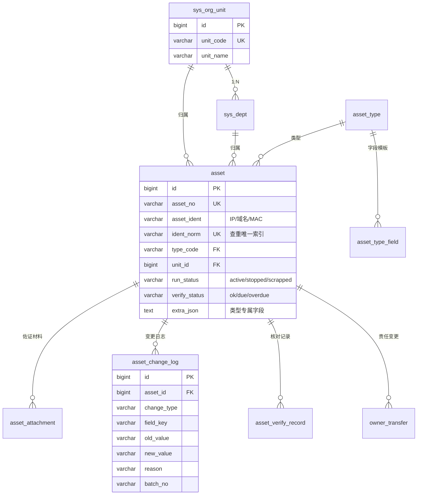

# 互联网资产与信息系统管理平台 · 后端服务

> Spring Boot 3.5 + MySQL 9 · 对应《软件需求规格说明书》FR-01 ~ FR-25 的服务端实现

本工程配合仓库中的 `需求规格说明书` 与 UI 原型，提供资产登记、台账维护、状态流转、批量操作、定期核对、责任人变更、统计导出等能力。

> 返回 [仓库总览](../README.md) ｜ 在线原型：https://aimiliya825.github.io/internet-asset-registry/

---

## 目录

- [技术栈](#技术栈)
- [数据库设计](#数据库设计)
- [快速开始](#快速开始)
- [接口清单](#接口清单)
- [关键实现](#关键实现)
- [工程结构](#工程结构)
- [边界与后续](#边界与后续)

## 技术栈

| 项 | 版本 / 说明 |
| --- | --- |
| JDK | 21+（本地以 JDK 24 编译运行验证通过） |
| 框架 | Spring Boot 3.5.16 · Spring MVC · Spring Data JPA（Hibernate 6） |
| 数据库 | MySQL 8.0+ / 9.x，InnoDB，utf8mb4 |
| 构建 | Maven 3.9 |
| 校验 | Jakarta Bean Validation（`@Valid` + 全局异常处理） |
| 测试 | JUnit 5 + AssertJ + H2(MySQL 兼容模式) 端到端冒烟 |

未使用 Lombok：JDK 24 下注解处理器版本匹配存在风险，实体统一由脚本生成标准 getter/setter，避免编译期依赖。

## 数据库设计

库名 `asset_registry`，11 张表 + 1 个视图。脚本可重复执行（`01_schema.sql` 会先 DROP，再建）。



### 四两拨千斤的四个设计决策

**1. 唯一性校验下沉到数据库**
`ident_norm VARCHAR(120)` 存 `LOWER(TRIM(asset_ident))`，并建唯一索引 `uk_asset_ident_norm`。应用层查重给友好提示，数据库索引兜住并发同时提交的极端情况——两条一模一样的 IP 不可能同时入库。

**2. 类型差异用模板表而非宽表**
`asset_type_field` 存字段键、类型、必填、是否参与查重、下拉选项。新增资产类型只需插数据，不需要改 DDL，也不需要改 Java 代码。类型专属值落在 `asset.extra_json`，配 `CHECK (JSON_VALID(...))` 约束防止脏数据。

**3. 日志只增不改**
`asset_change_log` 记录"字段级"差异：变更人、时间、字段、前后值、原因、批次号。一次修改 5 个字段就落 5 行，而不是一行 JSON 快照——按字段反查"谁改过部署位置"才查得动。

**4. 不做物理删除**
停用/报废只改 `run_status`，资产行、附件、日志全部保留。台账默认口径按状态过滤，报废数据永久可查，满足审计要求。

## 快速开始

### 1. 建库

```bash
cd db
mysql -uroot -p --default-character-set=utf8mb4 < 01_schema.sql
mysql -uroot -p --default-character-set=utf8mb4 < 02_data.sql
```

> Windows 控制台默认 GBK，务必带 `--default-character-set=utf8mb4`（脚本首行也有 `SET NAMES utf8mb4` 兜底），否则中文注释与数据可能乱码。

执行完会输出建表数量与各表数据量。示例数据为 7 个单位、15 个部门、10 个用户、5 类资产、14 条资产台账。

### 2. 配置连接

密码通过环境变量注入，不落代码库：

```bash
# Windows PowerShell
$env:DB_PASSWORD="你的密码"
$env:DB_USERNAME="root"        # 可选，默认 root

# macOS / Linux
export DB_PASSWORD='你的密码'
```

数据库地址在 `src/main/resources/application.yml`，默认 `localhost:3306/asset_registry`。

### 3. 启动

```bash
mvn spring-boot:run
# 或
java -jar target/asset-registry-server.jar
```

服务监听 `http://localhost:8080`。

> **端口被改掉时**：Spring Boot 会把环境变量 `SERVER__PORT` 松散绑定成 `server.port`。若所在环境（如某些 IDE 宿主进程）预置了这个变量，服务会去绑一个被占用的端口并报 `Port xxx was already in use`。用命令行参数显式覆盖即可（优先级高于环境变量）：
>
> ```bash
> java -jar target/asset-registry-server.jar --server.port=8080
> # 或彻底移除该变量：env -u SERVER__PORT java -jar ...
> ```

### 4. 冒烟

```bash
curl http://localhost:8080/api/dashboard/summary
curl "http://localhost:8080/api/assets?keyword=网关&page=1&size=10"
```

> 本地联调默认以 `X-User-Id: 1` 识别用户（对应 `sys_user` 的 id）。接 SSO 网关后应改为从受信任的主体标识解析，见 `CurrentUserFilter`。

### 5. 跑测试（不需要 MySQL）

```bash
mvn test
```

测试用 H2 内存库 + 真实 HTTP 调用，覆盖：登记成功、重复标识 409、模糊查询、变更原因长度校验、状态流转留痕、看板与统计口径一致、字典接口。

### 6. 真实 MySQL 实测结果

本地 MySQL 9.7.0 建库灌数后，以下链路已逐一调用验证通过：

| 验证项 | 结果 |
| --- | --- |
| 建表 | 11 表 + 1 视图，中文注释与数据无乱码 |
| 唯一索引 | `uk_asset_ident_norm`、`uk_asset_no` 生效 |
| 看板聚合 | 总数 14 / 启用 11 / 待核对 3 / 停用报废 3，启用率 78.6%，三类图表序列与库一致 |
| 台账查询 | `keyword=sso` 命中 1 条，编号、类型、单位、状态下发正常 |
| 查重 | 重复登记 `www.yunqi-group.com` 返回 **409** |
| 类型化必填 | 域名类型缺备案号被拦，提示「域名备案号」为必填项 |
| 原因校验 | 变更原因不足 10 字返回 **400** |
| 状态机 | 启用→停用成功并落日志；重复设为停用被拒「状态未发生变化」 |
| 详情 | 扩展字段、2 份材料、变更记录、上次核对周期齐全 |
| 统计三维度 | `dim=type/unit/status` 聚合与总数自洽 |
| 待核对 / 变更申请 / 变更流水 | 分别为 3 条 / 1 条 / 9 条 |
| CSV 导出 | 带 UTF-8 BOM，Excel 直开不乱码，时间为 `yyyy-MM-dd HH:mm` |


## 接口清单

统一响应体：`{ "code": 0, "message": "success", "data": ... }`，业务错误返回对应 HTTP 状态码 + 非 0 code。

### 资产

| 方法 | 路径 | 说明 |
| --- | --- | --- |
| GET | `/api/assets` | 台账查询。`keyword`（名称/IP/域名/负责人/编号模糊）、`type`、`unitId`、`status`、`owner`、`from`、`to`、`page`、`size` |
| GET | `/api/assets/{id}` | 详情：资产 + 类型扩展字段 + 佐证材料 + 变更记录 + 最近核对周期 |
| POST | `/api/assets` | 登记。查重命中返回 **409**，并附带已登记资产名称与归属单位 |
| PUT | `/api/assets/{id}` | 修改。仅提交需要变更的字段，逐字段比对并落日志；无可变字段返回 400 |
| PATCH | `/api/assets/{id}/status` | 状态流转。`{"status":"stopped","reason":"≥10 字原因"}` |
| POST | `/api/assets/batch/status` | 批量状态更新。`{"ids":[...],"status":"...","reason":"..."}` |
| POST | `/api/assets/batch/field` | 批量修改。`{"ids":[...],"field":"ownerName","value":"王琳","reason":"..."}` |
| GET | `/api/assets/{id}/logs` | 该资产变更时间线 |
| POST | `/api/assets/{id}/attachments` | 上传佐证材料（multipart，字段 `file`、`materialType`） |

### 维护与统计

| 方法 | 路径 | 说明 |
| --- | --- | --- |
| GET | `/api/change-logs?type=` | 全量变更日志，可按变更类型过滤 |
| GET | `/api/verify/due` | 待核对资产清单 |
| POST | `/api/verify/{assetId}` | 提交核对结论。`{"result":"ok|need_fix|invalid","remark":"..."}` |
| GET | `/api/owner-transfers?status=` | 责任人变更申请列表 |
| POST | `/api/assets/{assetId}/owner-transfers` | 发起责任人变更。`{"toUserId":3,"reason":"..."}` |
| POST | `/api/owner-transfers/{id}/decision` | 审批。`{"decision":"approve|reject","opinion":"..."}` |
| GET | `/api/stats/overview?dim=type&unitId=&from=&to=` | 多维统计，`dim` 支持 `type`/`unit`/`status` |
| GET | `/api/dashboard/summary` | 看板：指标卡 + 三组图表序列 + 待办 + 最近动态 |
| GET | `/api/exports/assets.csv` | 按当前筛选导出 CSV（带 BOM，Excel 直开不乱码） |
| GET | `/api/meta` | 字典：类型 + 字段模板 + 单位部门 + 状态 + 用户 |
| GET | `/api/me` | 当前用户 |

### 身份识别

服务通过请求头 `X-User-Id` 解析操作人（默认 1），用于日志与审计留痕。生产环境应由 SSO 网关校验并回传受信任的主体标识，`CurrentUserFilter` 是唯一需要替换的接入点。

## 关键实现

**登记查重（FR-04/05）**
先 `findByIdentNorm` 命中即抛 `BizException.conflict`，提示「重复对象 + 归属单位 + 当前状态」；漏网并发由唯一索引兜底，`DataIntegrityViolationException` 统一转 409。

**状态机（FR-10）**
`RunStatus.canTransitTo()` 显式声明允许的流转：启用 ⇄ 停用、启用→报废、停用→报废、报废→启用（需审计）。同状态变更直接拒绝并提示"当前已是 X"。

**变更留痕（FR-12）**
`AssetService.update()` 用 `LinkedHashMap<String,String[]>` 收集字段差异，逐条写日志；`batchNo` 把一次批量操作串联起来，日志页可下钻。

**批量操作（FR-14/15）**
逐条处理、跳过不合法项，最终 `changed == 0` 才报错——避免"选了 10 条实际改了 0 条却提示成功"。

**定期核对（FR-17）**
登记与恢复启用时把 `verify_due_date` 设为 +3 个月；核对结论 `ok` 刷新到期日，`invalid` 标为超期；核对动作本身也进变更日志。

**导出**
CSV 用 `\uFEFF` BOM 头 + 全字段加引号转义，中文 Excel 直接打开不乱码；导出行为写 `sys_audit_log`（FR-24）。

## 工程结构

```
asset-registry-server/
├─ db/
│  ├─ 01_schema.sql          建库建表（11 表 + 1 视图 + 索引 + 约束）
│  └─ 02_data.sql            示例数据
├─ tools/gen_entities.py     实体生成器（字段清单 → Java 实体）
├─ src/main/java/com/asset/registry/
│  ├─ common/                统一响应、分页、业务异常、状态枚举、全局异常处理
│  ├─ config/                当前用户上下文与过滤器、CORS、Jackson 时间格式
│  ├─ entity/                11 个 JPA 实体
│  ├─ repository/            11 个 Repository（含分组统计 JPQL）
│  ├─ dto/                   Payloads（入参校验）、Views（出参）
│  ├─ service/               Asset / Meta / Stats / ChangeLog / Verify / Transfer / Audit
│  └─ web/                   Asset / Stats / Maintenance / Meta 四个控制器
├─ src/main/resources/application.yml
└─ src/test/java/.../ApiSmokeTest.java
```

分层约定：`web` 只做参数绑定与响应包装；`service` 承担事务与业务规则；`entity` 不对外暴露，统一转 `Views` 输出。

## 边界与后续

- **不含登录鉴权**：按 SRS 设计委托给统一身份认证，本服务只做用户目录与角色字段。接 SSO 时替换 `CurrentUserFilter` 即可。
- **附件存本地**：`app.storage-root` 指定目录，生产建议换对象存储，`storage_path` 字段已预留相对路径语义。
- **通知未实现**：核对提醒、催办按 SRS 第 6 节走外部通知服务，`asset_verify_record.sent_at` 已预留。
- **前端未对接**：UI 原型目前使用内置 Mock 数据，接口已按原型的字段命名对齐（`typeCode`/`runStatus`/`verifyStatus` 等），可直接替换数据源。

> 说明：`v_asset_detail` 视图供 BI 与人工核查直接查询使用，应用内统计走 JPA 规格查询以保证可移植性，二者口径一致。
